# FluentSerial Native

真正原生的 Windows 串口调试工作台，使用 **.NET 10 + WPF** 构建。没有浏览器内核，没有 Electron / Tauri / WebView2 外壳；串口终端、端口预设、快捷指令、数据记录和设置全部是原生桌面界面。

- 原生窗口：WPF `FluentWindow` + Mica 背景 + 系统窗口按钮
- 串口引擎：`System.IO.Ports.SerialPort`，完整的数据位 / 校验 / 停止位 / 流控 / DTR / RTS / Break 控制
- 终端渲染：WPF `RichTextBox` 原生文本管线，支持文本与 HEX 两种视图、毫秒时间戳和跨读边界的安全换行
- 本地数据：`%APPDATA%\FluentSerial`，纯本机 JSON 存储；无遥测、无云同步
- 可执行文件：自包含单文件 `dist\FluentSerial-native-win-x64\FluentSerial.exe`
- 没有串口硬件也能完整体验：应用内置 **DEMO 回环**端口，会模拟设备应答与周期遥测

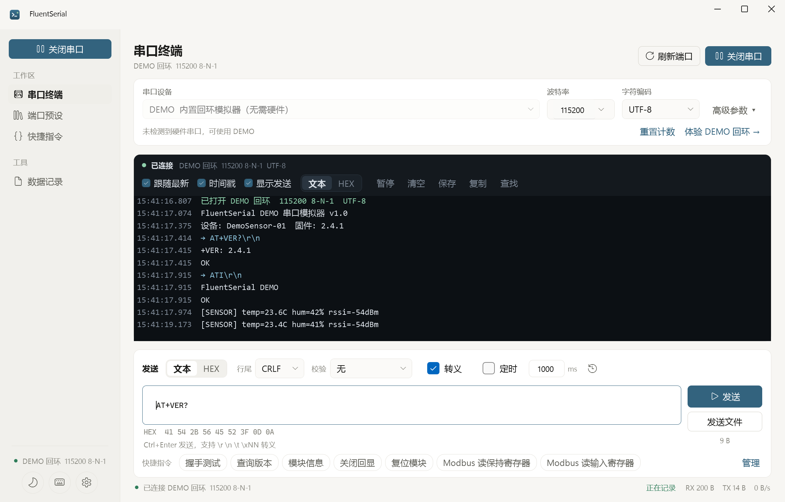
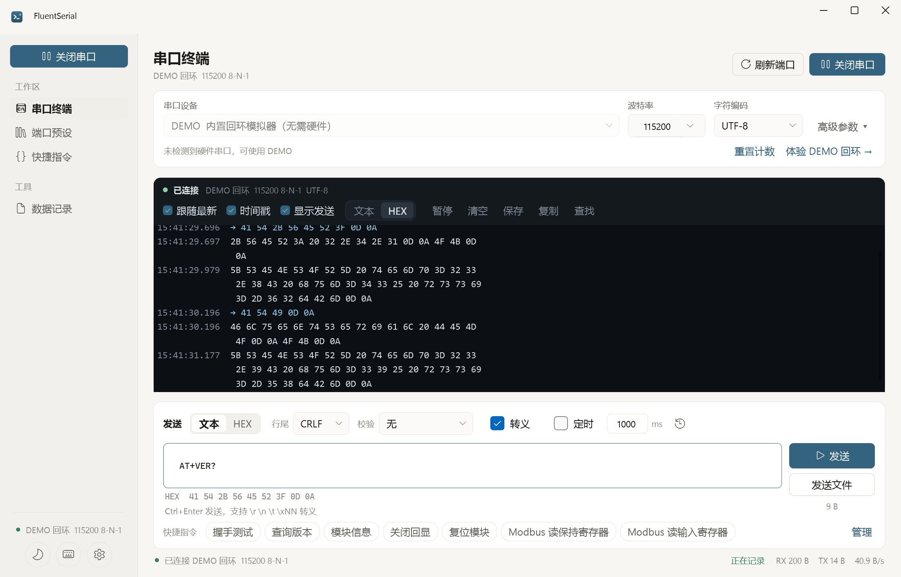

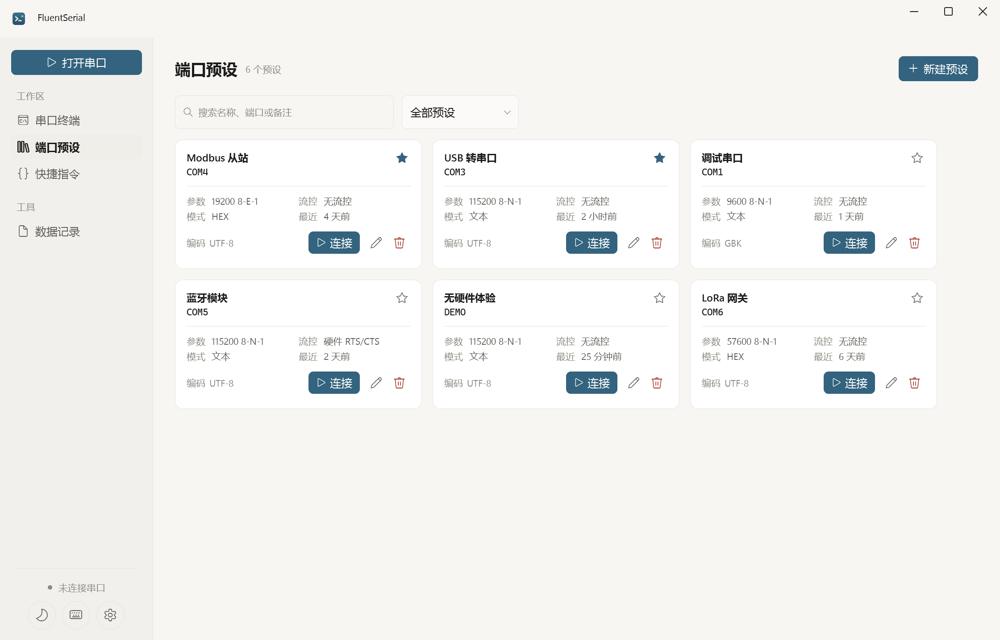
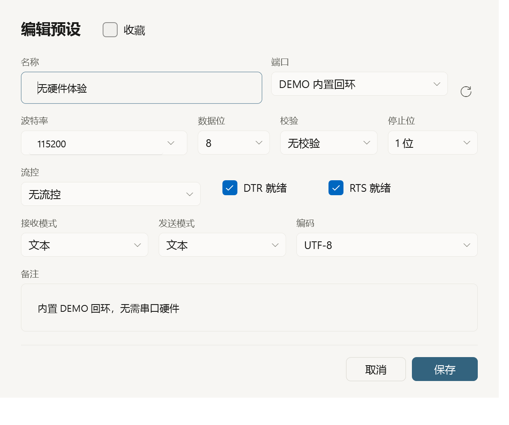
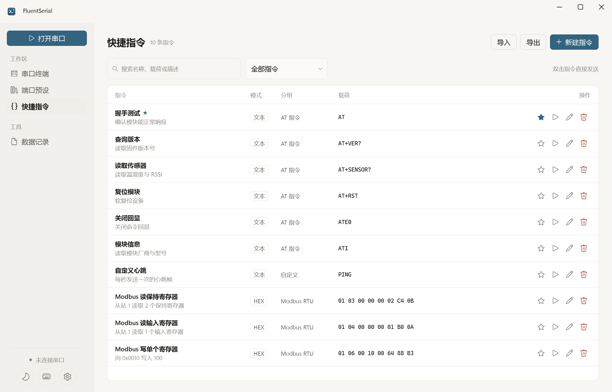
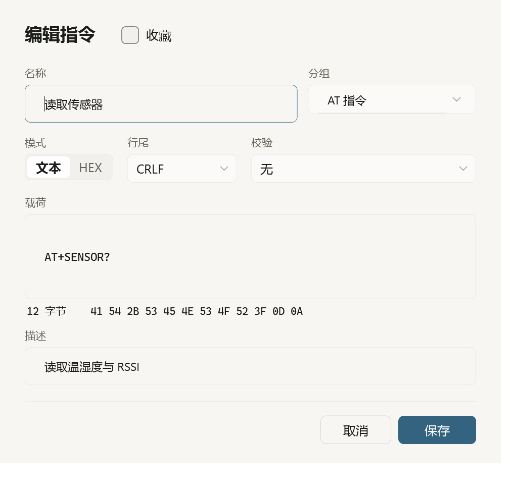
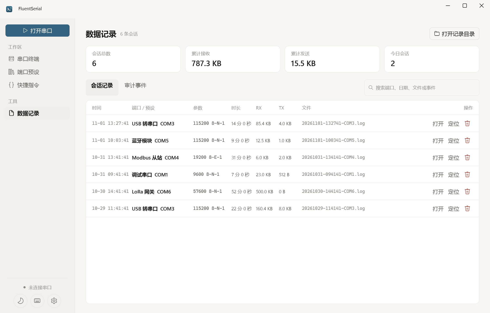
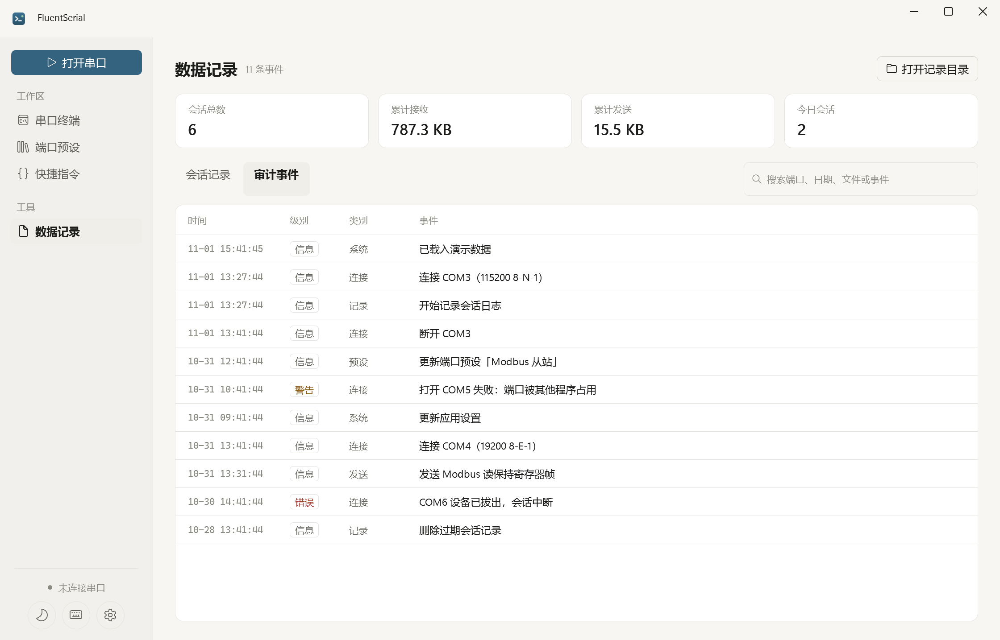

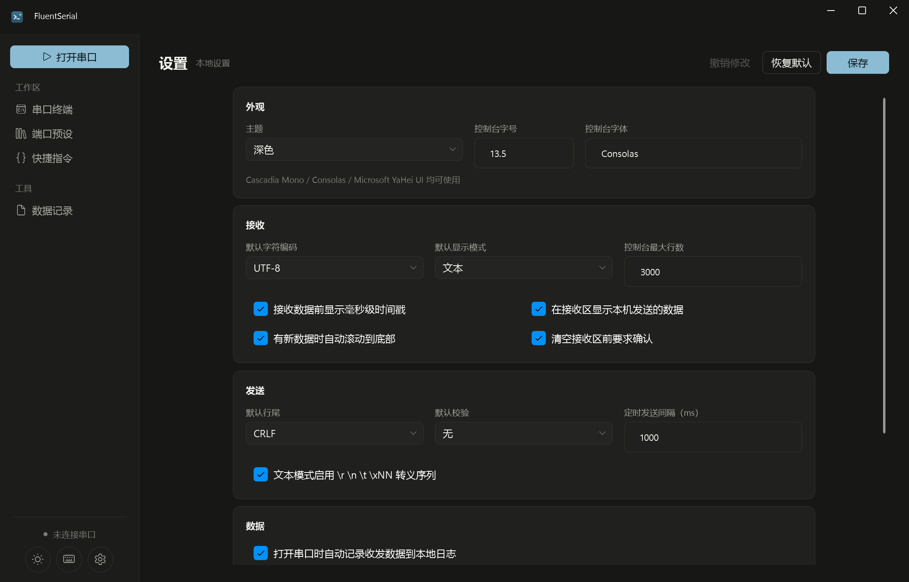
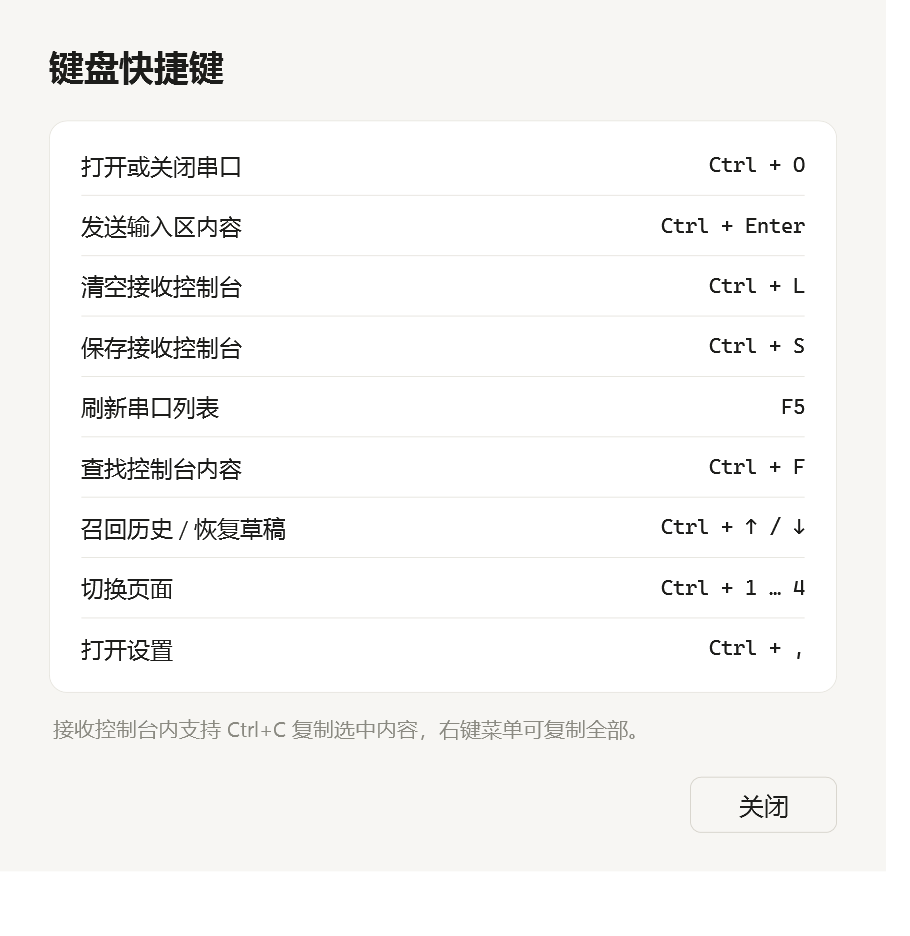
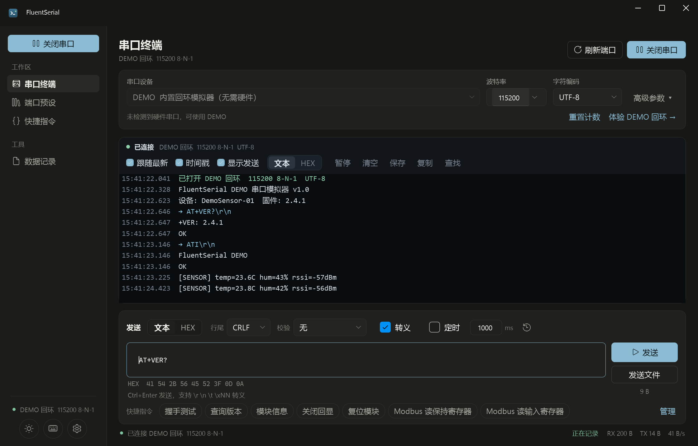

更多截图：[`docs/native/`](docs/native)

---

## 功能

### 串口连接

- 串口枚举带设备友好名称（SetupAPI），刷新按钮与 `F5` 热刷新
- 波特率可编辑（1–4000000）；数据位、校验、停止位、流控收在可折叠的高级参数中
- DTR / RTS 实时电平控制，`Break` 信号，收发计数随时重置
- 端口占用、设备拔出、IO 异常均有中文错误提示，状态来自真实串口事件
- 内置 `DEMO` 回环模拟器：欢迎信息、周期遥测、AT 指令应答，无需硬件
- 打开串口参数写回本地设置，下次启动自动恢复

### 原生串口终端

- 文本 / HEX 双视图，一键切换并重排历史数据
- 毫秒时间戳、发送回显、最大行数限制、暂停与继续；工具栏可切换“跟随最新”
- `Ctrl+F` 查找当前控制台内容，支持上一处/下一处与循环查找；定位结果时暂停自动跟随
- 文本编码 UTF-8 / GBK / ASCII / Latin-1，GBK 中文日志直接可读
- 跨读取边界的 CRLF 安全处理，不会切出多余空行
- 清空、复制选中、复制全部、保存控制台到本地日志
- 状态栏实时显示 RX / TX 总字节与接收速率

### 发送

- 文本 / HEX 发送，HEX 支持完整字节组、空格、逗号、`0x` 前缀；不完整字节或非法字符即时提示
- 发送区实时显示实际字节数与 HEX 预览，包含所选编码、转义、校验与行尾
- 行尾：无 / CR / LF / CRLF
- 校验追加：SUM8、XOR8、CRC16-Modbus（低字节在前）、CRC16-CCITT（高字节在前）
- 文本转义：`\r` `\n` `\t` `\0` `\\` `\xNN` `\uNNNN`
- 定时发送（50–60000 ms）、发送历史（`Ctrl+↑ / Ctrl+↓` 召回，返回时保留未发送草稿）
- 文件按原始字节异步分块发送，最大 128 MB，显示进度并支持取消；不追加行尾或校验，取消等待当前块写入完成
- `Ctrl+Enter` 发送，并拦截中文输入法组字过程中的 Enter

### 快捷指令

- 内置 AT 指令与 Modbus RTU 模板，可继续新增、编辑、分组、收藏
- 搜索与分组筛选、就地收藏/取消收藏、一键重置筛选；双击或点击即可发送
- 指令编辑器内实时显示字节数与 HEX 预览，非法 HEX 即时提示
- 串口未打开时，指令会先载入发送区，不会静默丢失
- 支持 JSON 导入 / 导出；导入前整批校验，拒绝非法模式/HEX/空报文，跳过完全相同的指令，单次最多 4 MB / 1000 条

### 端口预设

- 常用串口配置保存为预设，包含端口、波特率、校验、流控、DTR/RTS、编码与收发模式
- 卡片直接收藏/取消收藏、搜索与筛选重置，展示最近使用时间、编码与接收模式
- 一键连接、编辑、删除；双击卡片直接打开终端

### 数据记录与审计

- 自动会话记录：时间、端口/预设、参数、时长、RX/TX 字节、文件路径
- 记录文件为 UTF-8 文本，每条报文包含时间戳、方向、长度、HEX 与可读文本
- 按端口、日期、文件名或事件内容搜索，显示筛选结果数与空结果提示
- 会话记录一键打开或定位到资源管理器，删除前确认；活动会话禁止删除，文件缺失有明确提示
- 审计事件：连接、断开、失败、预设修改、设置变更，可回溯

### 桌面体验

- 浅色 / 深色 / 跟随系统主题，切换即时生效
- 默认窗口 1280 × 820，最小 1080 × 740；高级参数按需展开，为接收区留出更多空间
- 所有页面共享本地设置与 Roaming 数据目录；设置草稿在页面切换后保留，可撤销修改再恢复已保存值
- 键盘导航：`Ctrl+1..4` 切换页面，`Ctrl+O` 开关串口，`Ctrl+L` 清空控制台，`Ctrl+S` 保存控制台（在设置页保存设置），`Ctrl+F` 查找控制台，`Ctrl+,` 设置
- 原生窗口最大 / 最小 / 关闭按钮与 Per-Monitor DPI 缩放
- 自包含单文件发布，不需要安装 .NET 运行时

## 本轮优化记录

- 修复分包 CRLF 在发送回显/系统消息插入时产生额外空行、暂停时仍重排内容等显示问题；连续无换行数据分段处理，渲染队列有界。
- 修复 UTF-8 转义发送中的 emoji / Unicode 代理对损坏，收紧 HEX 字节组校验。
- 会话日志使用唯一文件名并禁止覆盖；重置界面计数不会清除整场会话累计，旧连接的延迟写入不会计入新会话。
- 修复设置接受 NaN / Infinity 字号、导航丢失设置草稿，以及指令分组名 `all` / `favorites` 与筛选标记冲突的问题。
- 截图与 UI 测试使用每次运行独立的数据目录，保留报告；脚本不再终止其他正在运行的 FluentSerial 会话。

## 设计规范

界面遵循 [`desktop-agent-ui`](https://github.com/Ludi-Herry/desktop-agent-ui) 的桌面视觉规则：

- 中性分层 Surface，不使用装饰性阴影与左边缘彩条
- 0.5px 发丝边框；嵌套容器使用同心圆角（10 / 6 / 4）
- 全局字号收敛为 20 / 13 / 12 三档，正文不小于 12px
- 禁用中点分隔符，移除冗余副标题，让布局本身承担层级
- 控制台在浅色主题下也保持深色仪器面板，收发用颜色与方向箭头区分
- 状态与真实事件对应：连接、暂停、记录和计数器均来自实际串口流量

## 构建与运行

环境要求：Windows 10/11 x64，.NET 10 SDK。

```powershell
# 直接运行（开发）
dotnet run --project native\FluentSerial\FluentSerial.csproj

# 构建 Release
dotnet build native\FluentSerial\FluentSerial.csproj -c Release

# 发布自包含单文件
powershell -NoProfile -ExecutionPolicy Bypass -File scripts\native-publish.ps1
```

也可以双击 `start.cmd`：存在已发布版本时直接启动，否则先构建再运行。

发布产物：

```text
dist\FluentSerial-native-win-x64\FluentSerial.exe   # 直接双击运行
dist\FluentSerial-native-win-x64.zip                # 便携压缩包
```

## 测试

2026-11-01 本地验证：Release 构建零警告、零错误；核心回归 128 项通过，真实 WPF 界面回归 44 项通过（含最小窗口布局）。便携版另行运行同一套界面回归。

Smoke 测试覆盖 HEX / Unicode 转义 / 校验算法 / DEMO 收发 / 会话生命周期与累计计数 / 日志防覆盖 / 指令导入校验去重 / 文件分块发送与取消：

```powershell
dotnet run --project native\FluentSerial.Smoke\FluentSerial.Smoke.csproj -c Release
```

UI 冒烟测试会操作真实 WPF 页面，覆盖 DEMO 收发、文本/HEX 与主题切换、分包换行和暂停、发送预览、控制台查找、设置草稿与非法输入、日志搜索、收藏筛选及会话记录落盘：

```powershell
powershell -NoProfile -ExecutionPolicy Bypass -File scripts\ui-smoke.ps1
```

UI 测试报告位于 `data\ui-smoke\<运行 ID>\ui-smoke.txt`。截图脚本为每张图片建立 `data\capture\<运行 ID>\<图片名>` 数据目录；两者均隔离于真实 `%APPDATA%` 数据：

```powershell
powershell -NoProfile -ExecutionPolicy Bypass -File scripts\capture.ps1
```

也可以单独截图；直接调用程序时需显式设置隔离数据目录：

```powershell
$previousDataDirectory = $env:FLUENTSERIAL_DATA_DIR
$env:FLUENTSERIAL_DATA_DIR = Join-Path $PWD ("data\capture-manual\" + [Guid]::NewGuid().ToString("N"))
try {
    Start-Process -FilePath native\FluentSerial\bin\Release\net10.0-windows\FluentSerial.exe `
      -ArgumentList '--capture docs\native\terminal.png --page terminal --demo --theme Light --delay 1200' `
      -WindowStyle Hidden -Wait
}
finally { $env:FLUENTSERIAL_DATA_DIR = $previousDataDirectory }
```

## 数据目录

```text
%APPDATA%\FluentSerial\
├── store.json         # 端口预设、快捷指令、会话元数据、审计事件、设置
├── logs\              # 会话记录文件（UTF-8 文本）
├── exports\           # 快捷指令等导出内容
└── app.log            # 仅本地诊断日志
```

删除该目录即可完全清除本地数据。应用不访问网络，也不会上传任何串口内容。

## 架构

串口数据流、线程模型、本地存储格式与测试策略见 [`docs/ARCHITECTURE.md`](docs/ARCHITECTURE.md)。

## 项目结构

```text
native/FluentSerial/
├── App.xaml                 # 启动、主题、全局异常处理、截图模式
├── MainWindow.xaml          # 原生外壳、侧栏与页面导航
├── Core/                    # 串口传输、端口枚举、DEMO 回环、编解码、校验、存储、记录、审计
├── Dialogs/                 # 预设、指令、确认、快捷键对话框
├── Features/                # 终端、预设、指令、记录、设置
├── Themes/                  # Light / Dark 设计令牌与 Fluent 控件样式
└── Assets/                  # 应用图标
native/FluentSerial.Smoke/   # 核心层 Smoke 测试
scripts/                     # 构建、发布、截图、图标生成
docs/native/                 # 原生界面截图
```

## 已知边界

- 仅支持 Windows；未提供 macOS / Linux 版本
- 本轮验证使用 DEMO 与自动化测试，尚未验证物理串口硬件、设备拔插和真实硬件流控
- 内置 DEMO 是应用内模拟器，不会创建真实的虚拟 COM 端口对
- 不包含示波器式曲线绘制与脚本引擎，专注于串口收发与协议调试
- 控制台查找针对当前保留的显示内容；原始历史最多保留 5000 条 / 2 MB，超出后移除最早内容
- 多字节编码按流式解码，单次读取边界不会破坏 UTF-8 / GBK 字符
- CRC16-Modbus 按协议惯例低字节在前，CRC16-CCITT 采用高字节在前

## License

MIT
